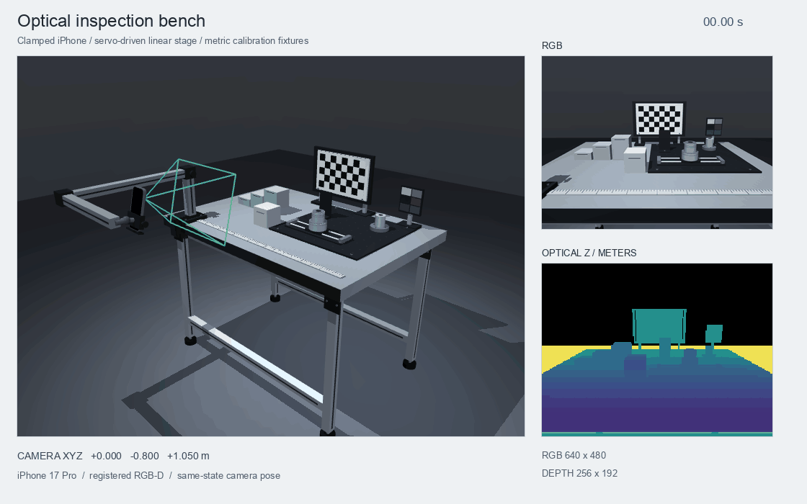
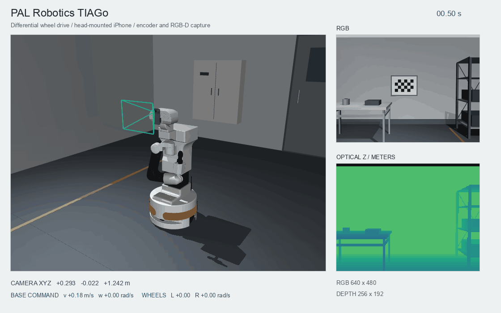
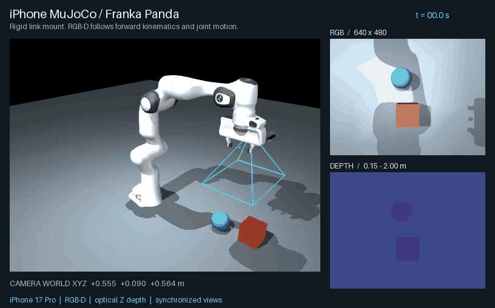

# iPhone MuJoCo

[简体中文](README.zh-CN.md) · [](https://github.com/ddwty/iphone-mujoco/actions/workflows/ci.yml)

Put a virtual iPhone on a table, a robot wrist or a moving platform and collect
RGB-D, calibration, camera poses and replayable episodes. Connect a real iPhone
through the existing PyPI `asmagic` SDK when your experiment needs live input.
[Python SDK](https://pypi.org/project/asmagic/)



The animations are generated from MuJoCo renders with synthetic calibration.
The lab provides known-size objects, depth steps, a checkerboard and occlusion
for testing camera projection, point clouds and data collection.

## Start with an offline experiment

Use Python 3.10 or newer to install from source.

```bash
git clone https://github.com/ddwty/iphone-mujoco.git
cd iphone-mujoco
python3 -m venv .venv
source .venv/bin/activate
python -m pip install -e .
iphone-mujoco doctor
```

On Windows, create the environment with `py -m venv .venv` and install with
`.venv\Scripts\python.exe -m pip install -e .`. Use the environment's
`python` and `iphone-mujoco` for the remaining commands, or their full paths
`.venv\Scripts\python.exe` and `.venv\Scripts\iphone-mujoco.exe`.

| Platform | Open the interactive laboratory |
|---|---|
| macOS | `mjpython -m iphone_mujoco phone-lab` |
| Linux | `.venv/bin/python -m iphone_mujoco phone-lab` |
| Windows | `.venv\Scripts\python.exe -m iphone_mujoco phone-lab` |

Move the phone with arrow keys and Q/E, rotate with J/L and I/K, press B to
scan, and press P to save RGB-D and point clouds. On macOS you can also open
`Open Phone Lab.command` after running `setup.command`.

Rendering uses OpenGL. A headless Linux host needs a supported EGL driver or
Xvfb/GLFW configuration. `--headless` still renders sensor images.

## Choose a camera experiment

| Experiment | Camera placement | Useful output | Example use |
|---|---|---|---|
| Tabletop | External camera on a stand | RGB-D, K, optical pose, point clouds | Detection, depth geometry, occlusion and calibration pipelines |
| Robot wrist | Rigidly attached to an arm link | RGB-D with same-state joints and controls | Eye-in-hand observations, trajectory datasets, visual-servo input |
| Mobile platform | Camera attached to a scripted base | RGB-D, base/camera pose and simulation time | RGB-D odometry input, multiview fusion and viewpoint coverage |
| Your MJCF | Camera attached to a named body | Same frame/episode API | Reuse an existing robot, room or task scene |

### External camera and tabletop data

```bash
python examples/scene_camera.py --scenario tabletop \
  --duration 4 --fps 10 --headless --output recordings/tabletop
iphone-mujoco inspect-episode recordings/tabletop/episode --json
```

Use the known dimensions to check reconstruction scale, depth-edge handling and
pixel-to-ray projection. Pass `--profile profiles/my-iphone.json` to use measured
intrinsics. Omitting it selects the labeled synthetic example.

### A camera on a moving robot



```bash
python examples/scene_camera.py --scenario mobile \
  --duration 6 --fps 10 --output recordings/mobile
```

On macOS, replace `python` with `mjpython` for examples that open a viewer.
The primitive base follows a scripted kinematic path. Its camera produces
changing viewpoints and poses for odometry or mapping experiments. Add your
own state estimator or reconstruction algorithm to process those observations.
The native viewer shows RGB and metric-depth previews beside the scene.

### Wrist cameras on different arms



| `--robot` | Laboratory arm | Camera parent | End effector |
|---|---|---|---|
| `panda` | Franka Emika Panda, 7 arm axes | `hand` | Parallel gripper |
| `ur5e` | Universal Robots UR5e, 6 arm axes | `wrist_3_link` | Bare flange |

Download the Panda model, generate a synthetic camera profile and collect your
first wrist sequence.

```bash
iphone-mujoco models --fetch panda
iphone-mujoco export-lab --output recordings/demo-rig
mjpython -m iphone_mujoco capture-wrist --robot panda \
  --profile recordings/demo-rig/calibration.json --show-phone \
  --duration 5 --fps 10 --output recordings/wrist-panda
```

Use `python -m iphone_mujoco` outside macOS. Select UR5e for a six-axis arm.
Download each model once, then reuse its local cache for subsequent runs.

```bash
iphone-mujoco models --fetch ur5e
mjpython -m iphone_mujoco capture-wrist --robot ur5e \
  --profile recordings/demo-rig/calibration.json --show-phone \
  --duration 5 --fps 10 --output recordings/wrist-ur5e
```

The download retains upstream licenses and verifies asset hashes. `--show-phone`
adds an approximate visual shell. Default mounts are demonstration transforms.
For a measured rig, supply `--mount measured-mount.json`. Joint motion drives the
rig through forward kinematics, and RGB, depth and robot state share one physics
state. Use `--motion hold` for a stationary joint target.
The wrist viewer displays the captured RGB and depth alongside the robot.

Both arms use MJCF and mesh assets maintained in Google DeepMind's MuJoCo
Menagerie, pinned to an upstream commit. Robot adapters, model provenance and
joint/actuator contracts are documented in the developer guide. [Menagerie](https://github.com/google-deepmind/mujoco_menagerie) · [Developer guide](docs/development.md)

### Attach the camera to your own scene

Use an existing MJCF and a mount JSON describing the local optical-camera-to-parent
transform.

```bash
python examples/scene_camera.py --scenario custom \
  --scene path/to/scene.xml --parent-body flange \
  --mount path/to/mount.json --profile profiles/my-iphone.json \
  --duration 4 --fps 10 --output recordings/custom-scene
```

The named parent can be a robot flange, mobile base, head or a static support.
Camera pose follows that body's transform. A complete runnable custom-scene
example and the mount schema are in the camera guide. [Camera mounting guide](docs/phone-lab.md)

For native MJCF reuse, export the module and include it under your selected
`worldbody` or robot body.

```bash
iphone-mujoco export-phone --output recordings/iphone.xml
```

## Use the recorded data

Wrist collection writes RGB PNG, UInt16 depth PNG, calibration, mounting
extrinsics, `states.jsonl`, a point-cloud preview and an `episode/` directory.
Scene examples use the same replay API. Start with the episode to retain
calibration, poses, metadata and distinct clocks.

```python
from iphone_mujoco.recording import ReplaySource

with ReplaySource("recordings/wrist-panda/episode") as source:
    frame = source.poll().rgbd
    rgb, depth_m = frame.rgb, frame.depth_m
    K_rgb = frame.calibration.matrix
    K_depth = frame.calibration.depth_calibration().matrix
    world_from_camera = frame.world_from_camera
    qpos = frame.metadata["robot_state"]["qpos"]
    world_points = frame.point_cloud(world=True)
```

Fuse a mobile-camera sequence into a voxelized world-frame point cloud using
its recorded optical poses.

```bash
python examples/fuse_episode.py recordings/mobile/episode \
  --output recordings/mobile-map --voxel-size .01 --stride 4
```

This example averages points/colors in a voxel grid for static scene geometry.
It writes `points.ply`, frame provenance and a summary with counts and bounds.
Wrist state/image pairs can also feed your own imitation-learning dataset
converter. Dataset schemas and PNG reading are covered in the wrist guide.
[Wrist data guide](docs/wrist-rgbd.md)

## Connect your real iPhone

Install the optional live dependencies and capture the current device K.

```bash
python -m pip install -e '.[live]'
iphone-mujoco calibrate --ip YOUR_IP --output profiles/my-iphone.json
```

In asMagic open **Stream**, enable RGB/depth, choose **Y up** and disable custom
coordinate adjustments. The app's Z-up preset uses `--pose-convention robotics`.
Reacquire calibration after changing capture settings.

To control the simulated wrist camera, switch to **Robot control → Through Mac**
and start sending. Release Square once after connecting, then hold it to move.

```bash
mjpython -m iphone_mujoco capture-wrist --robot panda \
  --profile profiles/my-iphone.json --show-phone --ip YOUR_IP \
  --duration 0 --output recordings/phone-controlled-wrist
```

This workflow uses phone poses/buttons for control and MuJoCo RGB-D for the
wrist observations. Stream and Robot control share port 8000 and operate as
separate app workflows. To record real RGB-D, use the Stream page and run
`iphone-mujoco record --ip YOUR_IP --mode camera --duration 10 --output recordings/phone`.

## Data conventions and current scope

| Quantity | Convention |
|---|---|
| RGB | `uint8`, H×W×3, RGB channels, raw raster orientation |
| Depth | Optical-axis Z in meters, invalid metric samples are NaN |
| UInt16 export | Explicit meters/code, normally `0.0001`, zero invalid, 65535 reserved |
| Intrinsics | Full fx/fy/cx/cy with separate RGB/depth dimensions |
| Optical pose | MuJoCo Z-up world ← CV camera, X right, Y down, Z forward |
| Time | Simulation, sender and local receipt clocks remain distinct |

The included phone geometry and default mounts are approximate. Real rigs need
measured mounting extrinsics and device calibration. RGB-D rendering uses an
ideal pinhole model. LiDAR noise/confidence, exposure, rolling shutter and lens
distortion require additional sensor modeling. Robot control provides bounded
simulation targets, and precision following and physical robot experiments
require their own validation.

## Documentation

- [Camera laboratory and mounting](docs/phone-lab.md) · [Wrist RGB-D datasets](docs/wrist-rgbd.md)
- [Developer guide](docs/development.md) · [Contributing](.github/CONTRIBUTING.md) · [Security](.github/SECURITY.md)
- [Releases](https://github.com/ddwty/iphone-mujoco/releases) · [MIT license](LICENSE)

Keep recordings, profiles, model caches and validation output in ignored local
directories. Use a new output directory for each experiment.
