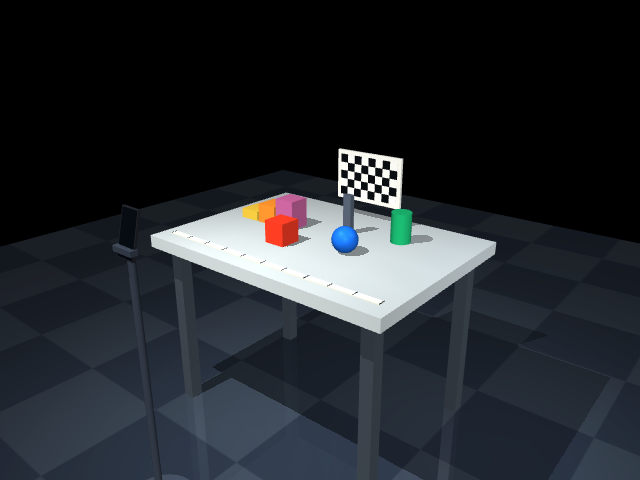

# iPhone MuJoCo



[English](README.md)

将虚拟 iPhone 作为 MuJoCo 的 RGB-D 相机，再让真实 iPhone 接入相同的数据工作流。
工具提供可见相机模组、离线实验台、腕部采集、受限机械臂遥操作与回放。
真机连接是可选功能，使用已有 [PyPI `asmagic` SDK](https://pypi.org/project/asmagic/)
和 asMagic app；不复制通信、Protobuf 或图像解码实现。

离线演示不需要真实手机、网络连接或模型下载。默认参数明确标为 synthetic，
不是所有 iPhone 通用的出厂标定。

## 新下载项目后如何启动

Python 3.10 及以上，在项目根目录运行：

```bash
python3 -m venv .venv
source .venv/bin/activate
python -m pip install -e .
iphone-mujoco doctor
```

Windows 可用 `py -m venv .venv` 创建环境，再执行
`.venv\Scripts\python.exe -m pip install -e .`，无需修改系统执行策略。

| 系统 | 打开实验台 |
|---|---|
| macOS | `mjpython -m iphone_mujoco phone-lab` |
| Linux | `.venv/bin/python -m iphone_mujoco phone-lab` |
| Windows | `.venv\Scripts\python.exe -m iphone_mujoco phone-lab` |

主画面显示手机和视锥，旁边显示镜头的 RGB 与深度。方向键移动手机，Q/E 升降，
1/2 切换总览/镜头，P 保存数据。macOS 也可使用 `setup.command` 和
`Open Phone Lab.command` 启动。

渲染需要可用的 OpenGL。`--headless` 只关闭交互窗口，仍需要图形上下文；有兼容
驱动的 Linux 服务器可配置 `MUJOCO_GL=egl`。`doctor` 环境提示不代表图形测试通过。

```bash
iphone-mujoco phone-lab --headless --output recordings/first-lab
iphone-mujoco inspect-episode recordings/first-lab/capture-0000/episode
```

请为每次实验使用新的输出目录，已有录制不会静默覆盖。

## 在自己的场景中使用 iPhone 模组

```bash
iphone-mujoco export-lab --output recordings/exported-lab
```

导出完整目录使用相对路径，可整体复制到其他计算机。macOS 运行
`mjpython -m mujoco.viewer --mjcf PATH`，其他系统运行
`python -m mujoco.viewer --mjcf PATH`，将 PATH 替换为导出的 `scene.xml`。
RGB-D 面板和 P 保存功能属于本包的 `phone-lab` 入口。

只导出相机模组时：

```bash
iphone-mujoco export-phone --profile profiles/my-iphone.json --output recordings/iphone.xml
```

`iphone.xml` 是 include 模组，放在自己的 `<worldbody>` 或机器人末端 body 内。
标定 JSON 保留深度尺寸；原生 MJCF camera 记录 RGB 成像参数。
多相机使用不同 body/camera 名，详见[模组导入说明](docs/phone-lab.md)。

```python
from iphone_mujoco import MujocoRGBDCamera
from iphone_mujoco.phone_scene import demo_calibration, load_phone_lab

k = demo_calibration()  # 合成示例；真机使用 CameraCalibration.load(...)
model, data = load_phone_lab(k)
with MujocoRGBDCamera(model, k) as camera:
    frame = camera.render(data)
    rgb, depth_m = frame.rgb, frame.depth_m
    points = frame.point_cloud(world=True).points
```

## 接入自己的真实 iPhone

```bash
python -m pip install -e '.[live]'
```

将 `YOUR_IP` 换成自己的手机局域网地址。在 asMagic 打开 **Stream**，开启 RGB/深度
发送，选择 **Y up** 并关闭自定义坐标调整。App 使用 Z up 时设置
`--pose-convention robotics`。

```bash
iphone-mujoco calibrate --ip YOUR_IP --output profiles/my-iphone.json
iphone-mujoco record --ip YOUR_IP --mode camera --duration 10 --output recordings/phone
iphone-mujoco inspect-episode recordings/phone --json
```

标定是当前相机配置的运行时快照，更换拍摄配置后应重新采集。
深度处理假设 ARKit sceneDepth 已注册到完整原始 RGB 画面，不进行显示旋转或裁剪。

## 腕部 RGB-D 与机械臂实验

```bash
mjpython -m iphone_mujoco capture-wrist --robot reference6 \
  --profile profiles/my-iphone.json --duration 5 --fps 30 --output recordings/wrist
```

纯离线试用可把 `export-lab` 导出的 synthetic `calibration.json` 作为 profile。
`--fps` 表示每个仿真秒采多少帧，不保证真实时间渲染吞吐。
Linux/Windows 将 `mjpython` 换成 `python`。

内置 `reference6`、`reference7` 不需下载；官方 Menagerie UR5e/Panda 按需下载，
固定提交、逐文件校验并保留上游许可证：

```bash
iphone-mujoco models --fetch panda
```

真机遥控在 asMagic 打开 **Robot control → Through Mac** 并发送。
程序连接后先松开 Square，再按住移动，松开保持：

```bash
mjpython -m iphone_mujoco teleop --ip YOUR_IP --robot panda \
  --translation-scale 0.25 --duration 0 --output recordings/teleop
mjpython -m iphone_mujoco replay recordings/teleop --robot panda --duration 0
```

控制器有重锚、关节/工作空间/速率限制和断流保持。App 的 Stream 与 Robot control
共享 8000 发布端口；遥控页发位姿和按钮，未发送 RGB-D，当前按独立工作流使用。

## 数据约定与边界

| 数据 | 约定 |
|---|---|
| RGB | `uint8`，H×W×3，RGB 通道，原始相机方向 |
| 米制深度 | 光轴 Z 深度，无效值 NaN |
| UInt16 导出 | 明确每单位多少米，通常 `0.0001`；0 无效，65535 保留 |
| 内参 | 完整 fx/fy/cx/cy，RGB 与深度各自的尺寸 |
| 光学位姿 | MuJoCo Z-up 世界 ← CV 相机，X 右、Y 下、Z 前 |
| 时间 | 区分仿真、发送端和本机收到时间 |

手机外观和默认腕部外参为近似示例。真实外形、质量/惯量、镜头安装位置、畸变、
LiDAR 噪声/置信度、曝光和滚动快门仍需测量或建模。控制器没有碰撞规避和硬件驱动；
自由运动试验存在明显动态目标残差，不能称为已验证的高精度遥操作系统。

## 开源开发

- [实验台与相机导入](docs/phone-lab.md) · [腕部数据](docs/wrist-rgbd.md)
- [架构与契约](docs/architecture.md) · [机器人适配](docs/extending.md)
- [协议核对](docs/protocol-audit.md) · [路线图](docs/roadmap.md)
- [贡献指南](CONTRIBUTING.md) · [安全说明](SECURITY.md) · [发布流程](docs/releasing.md)
- [更新记录](CHANGELOG.md) · [MIT 许可证](LICENSE)

公开源码不应包含个人标定、拍摄内容、录制轨迹、模型缓存和本机验证输出。
按改动范围验证并报告实际结果；CI、离线 fixture 和构建不能作为真实设备精度、
网络时延或硬件安全的证明。
