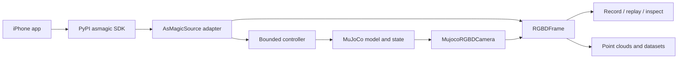

# Architecture and data contracts

Two sources meet at an explicit RGB-D contract: a MuJoCo renderer and a real
iPhone through an optional existing SDK. Known geometry and provenance remain
separate from physical sensor performance.



## Ownership

Public Python modules live under `iphone_mujoco`. Compatibility aliases do not
create another implementation.

| Module | Responsibility |
|---|---|
| `camera`, `geometry` | K, frame validation, projection, coordinate conversion and rendering |
| `profiles` | Calibration/provenance and cosmetic phone MJCF |
| `phone_scene`, `phone_lab` | Offline laboratory, interaction and snapshots |
| `streams` | SDK subscription adapters, local receipt state and freshness |
| `virtual_device` | Existing SDK-schema camera output and depth quantization |
| `robots`, `control` | Adapters, pinned assets and bounded simulated targets |
| `wrist` | Rigid link mounting and same-state camera/robot capture |
| `recording` | Versioned JSON/NPZ episodes and replay |
| `cli` | User workflows; it is not a second protocol implementation |

The optional SDK owns ZeroMQ transport, descriptors and JPEG/HEVC decoding.
Installation requires no Swift checkout. Optional robot assets are separately
downloaded, commit-pinned, hash checked and retain upstream licenses.

## Images, depth and calibration

`RGBDFrame` contains timestamp, optional RGB/depth/confidence, calibration,
optional optical world pose, source identity and metadata. Missing observations
stay `None`; invalid metric depth samples are NaN.

- RGB is `uint8 (H,W,3)`, RGB channels, raw raster orientation.
- Depth is optical-axis Z in meters, not distance along the ray.
- K preserves fx/fy/cx/cy, including unequal focal lengths and offset principal
  points. Nonzero skew is rejected.
- Depth K assumes full-frame registration and center-aligned resampling:
  `u' = (u + 0.5) * scale - 0.5`. Unknown crop/registration cannot be inferred.
- UInt16 exports use explicit meters/code, usually `0.0001`; zero is invalid,
  65535 reserved. Quantization/range gating are distinct from ideal rendering.
- Real confidence is optional measurement. Renderer validity or ideal wire
  confidence must not be described as measured LiDAR confidence.

`calibrate` writes the bare `CameraCalibration` JSON accepted by `--profile`.
`DeviceProfile` is a richer record with provenance and unknown physical values;
its JSON shape is different and is not a direct CLI profile replacement.

## Spatial frames

`RGBDFrame.world_from_camera` maps **CV optical camera** coordinates to MuJoCo
Z-up world. NumPy transforms multiply column vectors, translations occupy the
last column and distances are meters.

| Frame | Axes |
|---|---|
| CV optical camera | +X right, +Y down, +Z forward |
| ARKit/MuJoCo local camera | +X right, +Y up, −Z forward |
| Package world | MuJoCo robotics Z-up; conversion is explicit |

The current app wire message has no coordinate-mode/custom-adjustment field.
Camera input therefore requires a selected convention: `arkit` expects original
Y-up, `robotics` expects App Z-up. Robot control has its own raw ARKit sender.
Current wire pose is `[tx,ty,tz,qx,qy,qz,qw]`, with quaternion x/y/z/w order.

`AsMagicSource.pose` is already converted. Use `phone_to_world=np.eye(3)` when
passing it to the controller. The controller's default ARKit conversion is only
for raw input; do not apply both conversions.

Wrist mounts store a fixed parent-link ← CV-camera transform:

```text
world_from_camera = world_from_parent @ parent_from_camera
```

Default mounts and phone lens/body geometry are demonstrations, not measured
hand-eye calibration. Camera world pose follows robot forward kinematics;
camera code must not teleport a jointed robot to reproduce phone motion.

## Clocks, sessions and freshness

| Clock | Meaning |
|---|---|
| Simulation | `mjData.time`, advanced by physics integration |
| Sender wall | Preserved App timestamp; not synchronized receive time |
| Sender source | ARKit monotonic source value, scoped to source/session |
| Local receipt | Host monotonic arrival/event time used for freshness |

Do not subtract clocks on different machines to report one-way latency.
Frame IDs, sender sessions and receipt epochs preserve discontinuities. World
registration belongs to its session; an origin reset cannot reuse an unrelated
measured transform silently.

Pose and buttons are independent streams with separate timestamps/freshness.
A button update cannot refresh an old pose. First connect/reconnect must
observe Move released before accepting held Move. Invalid/stale/discontinuous
input holds the target and reanchors subsequent movement.

Wrist RGB, depth and robot state use one `mjData` state after a complete
physics step; no step occurs between RGB/depth/state sampling. Sampling starts
after positive simulation time because zero source-time means missing in the
current SDK path.

## Persistence and replay

An episode is a new directory containing a format/version manifest, per-frame
JSON and numeric NPZ. Readers disable pickle and reject unknown versions;
writers reject existing nonempty directories. Image/PLY exports are convenience
views; metadata retains calibration, times, frames, sessions and source.

The existing on-disk format identifier `asmagic-mujoco-episode` is retained
across the project rename. Package branding does not justify rewriting user data.

`ReplaySource` defaults to immediate iteration. `realtime=True` schedules by
recorded local event intervals, scaled by replay speed. Controller receipt time
is rebased while preserving original pose age. Fast-generated simulation receipt
intervals may differ from simulation time; scientific resampling must select
source/simulation timestamps explicitly.

`inspect-episode` reads without modification. It reports coverage, shape/K,
source/session and separate clock consistency. A structurally valid dataset is
not evidence of physical calibration quality or experiment correctness.

## Experiment boundaries

The lab is static geometry for camera/data experiments. The controller uses
damped Jacobian IK and position actuators with bounds. It is not a hardware
driver, planner or collision-avoidance system; moving-target residuals can be
substantial. Runtime profiles do not supply body mass/inertia, sensor noise,
exposure or true hardware latency. Preserve these limits in public claims.

## Local model caches

Use `IPHONE_MUJOCO_MODEL_CACHE` to choose a shared local model cache. The older
`ASMAGIC_MUJOCO_MODEL_CACHE` variable and existing previous-version cache remain
compatible; new installs use the canonical project cache directory. Neither
cache is included in source or release distributions.
