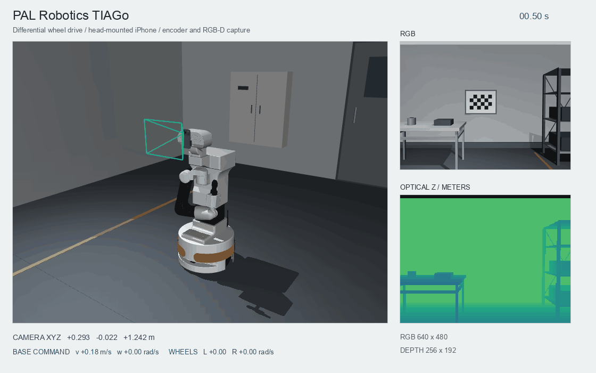

# 相机实验台与场景安装

虚拟 iPhone 包含可见手机外观、具名相机、RGB 内参和深度分辨率。
MuJoCo 渲染场景，采集接口输出与真实 iPhone 适配器共用的 `RGBDFrame`。

[](https://raw.githubusercontent.com/ddwty/iphone-mujoco/main/docs/images/phone-lab.gif)

[GIF](https://raw.githubusercontent.com/ddwty/iphone-mujoco/main/docs/images/phone-lab.gif)

## 打开实验台

在项目根目录运行实验台。

```bash
mjpython -m iphone_mujoco phone-lab
```

macOS 使用 `mjpython`，Linux/Windows 使用 `python`。
macOS 还可双击 **Open Phone Lab.command**，或在 **run.command** 中选择 1。
主画面显示手机、支架、实验台和视锥，旁边显示镜头 RGB 与米制深度预览。

| 按键 | 动作 |
|---|---|
| 方向键 | 在水平面移动手机 |
| Q / E | 降低 / 升高 |
| J / L | 左右转动 |
| I / K | 改变俯仰 |
| 1 / 2 | 总览 / 手机第一视角 |
| P | 保存 RGB-D、标定、位姿和点云 |
| R | 回到默认位置 |
| B | 开关缓慢扫描 |
| V / F | 开关预览 / 视锥 |

滚轮缩放、鼠标拖动改变总览视角。镜头数据由手机安装位姿决定。
添加 `--profile profiles/my-iphone.json` 可载入自己的运行时内参。

## 用已知几何检查算法

桌面宽 1.10 m、深 0.80 m，放有红色立方体、蓝色球、绿色圆柱、40/80/120 mm
台阶、35 mm 格子的棋盘板、100 mm 间距刻度和遮挡柱。

| 实验 | 操作 | 可检查的结果 |
|---|---|---|
| 相机投影与标定 | 对棋盘板运行角点检测，用 K 计算射线 | 重投影误差、视场和主点处理 |
| 深度几何 | 回投影台阶与物体，转换到世界坐标 | 尺度、平面、距离和点云坐标 |
| 遮挡与融合 | 按 B 扫描，保存多视角观测 | 深度边缘、可见面变化、配准输入 |
| 目标检测 | 采集颜色与形状已知的物体 | 检测程序输入、视点覆盖和输出可视化 |

按 P 会在本地输出目录新增一个 capture。

```text
rgb.png                 无损 RGB
depth_m.npy             float32 光轴 Z，单位米，无效值 NaN
depth_uint16.png        UInt16 深度，每单位 0.0001 m，0 无效
depth_preview.png       颜色预览
calibration.json        RGB K 与深度尺寸
capture.json            相机世界位姿、时间、来源与单位
points.ply              光学相机坐标点云
points_world.ply        世界坐标点云
episode/                统一回放格式
```

预览的颜色范围是 0.15–2 m。数值处理使用米制数组或 UInt16 文件。
UInt16 可表示范围之外的深度按无返回处理，PNG 与米制数组使用同一量化。

## 连续采集固定相机或移动平台

连续采集图像、位姿和场景状态。

```bash
python examples/scene_camera.py --scenario tabletop \
  --headless --duration 4 --fps 10 --output recordings/tabletop
python examples/scene_camera.py --scenario mobile \
  --headless --duration 6 --fps 10 --output recordings/mobile
```

省略 `--headless` 打开查看器，macOS 使用 `mjpython`。
用 `--profile` 指定相机标定，省略时使用示例内参。



[PNG](https://raw.githubusercontent.com/ddwty/iphone-mujoco/main/docs/images/mobile-camera.png) · [GIF](https://raw.githubusercontent.com/ddwty/iphone-mujoco/main/docs/images/mobile-camera.gif)

桌面场景的相机固定、目标移动，移动平台场景的相机随底盘沿预设轨迹运动。
`states.jsonl` 记录每帧光学位姿和场景状态，移动场景还包含 `world_from_base`。

```text
rgb/00000000.png        无损 RGB
depth/00000000.png      UInt16 深度
calibration.json        相机标定
camera_info.json        RGB/depth K、单位与来源
states.jsonl            位姿、仿真时间与状态
episode/                统一回放格式
preview_points.ply      第一帧的世界坐标点云
run.json                帧数、时间与运行信息
```

## 将完整场景导入普通 MuJoCo

```bash
iphone-mujoco export-lab --output recordings/exported-lab
python -m mujoco.viewer --mjcf recordings/exported-lab/scene.xml
```

macOS 查看器使用 `mjpython -m mujoco.viewer`。
导出目录含 `scene.xml`、`iphone.xml`、`calibration.json`、`scene_info.json`，
以及可安装到机器人上的 `iphone_fixed.xml` 与其标定。相对引用允许整体复制目录。
RGB-D 面板和 P 保存由本包的 `phone-lab` 入口提供，原生查看器可从相机列表选择
`iphone_camera`。

## 在已有 MJCF 中增加相机并采集

以下完整示例将第二个相机装到导出实验台的 `camera_stand`。更换 `--scene` 与
mount 的 `parent_body`，即可使用已有机器人的底盘、头部、法兰或固定支架。

```bash
iphone-mujoco export-lab --output recordings/custom-lab
python - <<'PY'
from iphone_mujoco.phone_scene import default_world_from_camera
from iphone_mujoco.wrist import WristCameraMount

pose = default_world_from_camera()
pose[0, 3] -= 0.25
WristCameraMount(
    "camera_stand", pose,
    camera_name="scene_iphone_camera", measured=False,
).save("recordings/custom-lab/mount.json")
PY
python examples/scene_camera.py --scenario custom \
  --scene recordings/custom-lab/scene.xml --parent-body camera_stand \
  --mount recordings/custom-lab/mount.json --headless \
  --duration 4 --fps 10 --output recordings/custom-data
```

`parent_from_camera` 将 CV 光学相机坐标映射到父 body 坐标，使用 4×4 矩阵，平移单位为米。
上述支架位于世界原点，所以可以直接使用该示例位姿。机器人末端需要填入实际的
局部安装变换。`measured=false` 表示演示安装，实测或手眼标定后更新该记录。
自定义安装同时保存 `mount.json`，相机通过父 body 的变换跟随场景运动。

## 导出独立相机模组

```bash
iphone-mujoco export-phone --output recordings/iphone.xml
```

加入 `--profile my-iphone.json` 可导出自己的标定，生成的
`iphone.calibration.json` 保存深度尺寸。将 include 放入自己的 MJCF。

```xml
<mujoco>
  <worldbody>
    <body name="camera_mount" pos="0 -0.8 1.0" euler="1.3 0 0">
      <include file="iphone.xml"/>
    </body>
  </worldbody>
</mujoco>
```

模组 include 用于组合场景，完整 `scene.xml` 用于单独加载。
机器人上的固定安装放在目标 body 内，多相机分别设置
`--body-name phone_left --camera-name camera_left` 等唯一名称。

```python
from iphone_mujoco import CameraCalibration, MujocoRGBDCamera, write_phone_module

k = CameraCalibration.load("my-iphone.json")
write_phone_module("iphone.xml", k)
# 将 include 加入 MJCF 并创建 model/data 后读取相机
with MujocoRGBDCamera(model, k, camera="iphone_camera") as camera:
    frame = camera.render(data)
    rgb, depth_m = frame.rgb, frame.depth_m
    world_points = frame.point_cloud(world=True)
```

真机连接通过 `[live]` 安装 PyPI `asmagic` SDK。
