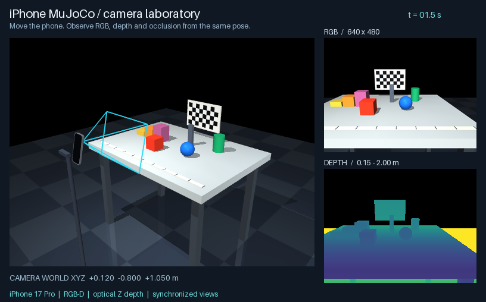
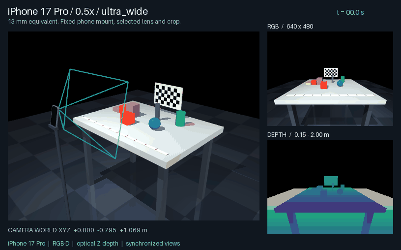

# Camera lab and scene mounting

Collect RGB-D, intrinsics and optical poses from the virtual iPhone's named
camera. Simulation and real-phone inputs share the `RGBDFrame` interface.

[](https://raw.githubusercontent.com/ddwty/iphone-mujoco/main/docs/images/phone-lab.gif)

[GIF](https://raw.githubusercontent.com/ddwty/iphone-mujoco/main/docs/images/phone-lab.gif)

## Camera configuration

Choose a model, physical rear lens or zoom preset, and output raster sizes.

```bash
iphone-mujoco devices
iphone-mujoco configure-camera --device iphone-17-pro --region cn \
  --zoom 0.5 --resolution 1280x960 --depth-resolution 256x192 \
  --output profiles/iphone-17-pro-ultrawide.json
```

The catalog includes iPhone 15 Pro/Pro Max, 16 Pro/Pro Max and 17 Pro/Pro Max.
Use `iphone-mujoco devices --device iphone-17-pro` to inspect dimensions,
regional mass, lens locations, camera presets and their Apple source URLs.



[PNG](https://raw.githubusercontent.com/ddwty/iphone-mujoco/main/docs/images/camera-lenses.png) · [GIF](https://raw.githubusercontent.com/ddwty/iphone-mujoco/main/docs/images/camera-lenses.gif)

| Selection | iPhone 17 Pro / Pro Max |
|---|---|
| `--lens ultra_wide` or `--zoom 0.5` | 13 mm equivalent ultra-wide lens |
| `--lens wide` or `--zoom 1` | 24 mm equivalent main lens |
| `--zoom 1.2` / `--zoom 1.5` | 28 / 35 mm equivalent crops of the main lens |
| `--zoom 2` | 48 mm equivalent crop of the main lens |
| `--lens telephoto` or `--zoom 4` | 100 mm equivalent telephoto lens |
| `--zoom 8` | 200 mm equivalent crop of the telephoto lens |
| `--resolution WIDTHxHEIGHT` | MuJoCo RGB raster |
| `--depth-resolution WIDTHxHEIGHT` | Registered optical-Z depth raster |
| `--region us` / `--region cn` | Published regional mass variant |

The phone body stays fixed when switching lenses. The optical center moves to
the selected lens; crop presets keep the same lens center. Output sizes set
the simulation rasters. A real capture's received dimensions determine its
calibration and available recording sizes. Zoom labels follow Apple's camera
controls; the published equivalent focal length determines the projection.

| Profile source | What it provides | Reuse |
|---|---|---|
| `configure-camera --device ...` | Ideal pinhole projection from Apple's published equivalent focal length | Select a supported lens/zoom and simulation resolution |
| `calibrate --device ...` | K and image dimensions received from the current AR RGB-D frame | Same device, main lens at 1×; same-aspect full-raster resizing |
| Existing bare calibration JSON | User-supplied fx/fy/cx/cy and dimensions | Bind with `configure-camera --device ... --profile ...` when the camera identity is known |

The public projection uses `f_pixels = f_equivalent_mm * hypot(width, height) /
hypot(36, 24)`, square pixels and a centered principal point. Its saved source
is `public_specs_ideal_pinhole`. Runtime profiles keep the measured principal
point and separate focal lengths. Simulated depth is registered optical Z;
hardware depth availability is established by a received AR depth frame.

Capture your phone's AR main-camera K with the live extra installed:

```bash
python -m pip install -e '.[live]'
iphone-mujoco calibrate --ip YOUR_IP --device iphone-17-pro --region cn \
  --output profiles/my-iphone.json
iphone-mujoco configure-camera --profile profiles/my-iphone.json \
  --resolution 1280x960 --depth-resolution 256x192 \
  --output profiles/my-iphone-resized.json
```

In asMagic, enable RGB and depth in **Stream → AR**. `calibrate` receives the
current capture settings; it does not switch the phone's lens or zoom.
Camera-only mode can select other rear lenses, but that RGB stream has no K or
depth. Reusing a bound profile with another device, lens, zoom or aspect ratio
is rejected. Pixel-center resizing follows `u' = (u + 0.5) * scale - 0.5`.

To move the virtual camera with live phone poses, keep AR RGB/depth sending
enabled and record paired episodes:

```bash
mjpython -m iphone_mujoco camera --ip YOUR_IP --device iphone-17-pro \
  --region cn --duration 10 --output recordings/paired-camera
```

This uses each received K and frame pose, saving `real/` and `simulation/`
episodes. The first frame establishes a relative alignment. Supply
`--world-transform alignment.json` when you have measured world registration.

## Open the lab

Run from the project root.

```bash
mjpython -m iphone_mujoco phone-lab --device iphone-17-pro --region cn \
  --zoom 0.5 --resolution 1280x960 --depth-resolution 256x192
```

Use `mjpython` on macOS and `python` on Linux/Windows. On macOS, you can also
open **Open Phone Lab.command** or choose option 1 in **run.command**.
The window shows the phone, stand, test objects and camera frustum, with RGB
and metric-depth previews alongside the scene.

| Key | Action |
|---|---|
| Arrow keys | Move the phone horizontally |
| Q / E | Lower / raise the phone |
| J / L | Turn left / right |
| I / K | Tilt the camera |
| 1 / 2 | Overview / phone camera view |
| P | Save RGB-D, calibration, pose and point clouds |
| R | Reset the phone pose |
| B | Toggle scanning motion |
| V / F | Toggle previews / frustum |

Scroll to zoom and drag to change the overview. The phone pose determines the
sensor view. Use `--profile profiles/my-iphone.json` to load a saved camera
configuration. A run without camera options uses the demonstration calibration.

## Lab geometry

The table is 1.10 m wide and 0.80 m deep. It holds a red cube, blue sphere,
green cylinder, 40/80/120 mm steps, a checkerboard with 35 mm squares, a ruler
with 100 mm spacing and an occluder.

| Experiment | Procedure | Output to check |
|---|---|---|
| Projection and calibration | Detect checkerboard corners and calculate rays with K | Reprojection error, field of view and principal-point handling |
| Depth geometry | Back-project the steps and objects into world coordinates | Scale, planes, distances and point coordinates |
| Occlusion and fusion | Press B to scan and save multiple views | Depth edges, visible surfaces and registration input |
| Object detection | Capture objects with known colors and shapes | Detector input, viewpoint coverage and visualization |

Press P to create a capture in the local output directory.

```text
rgb.png                 Lossless RGB
depth_m.npy             float32 optical Z in meters, NaN invalid
depth_uint16.png        UInt16 depth, 0.0001 m/code, zero invalid
depth_preview.png       Color preview
calibration.json        RGB K and depth dimensions
capture.json            Camera world pose, time, source and units
points.ply              Optical-camera point cloud
points_world.ply        World-frame point cloud
episode/                Replayable recording
```

The depth preview spans 0.15–2 m. Read numeric depth from the metric array or
UInt16 file. Values outside the UInt16 range use the invalid code. PNG and
metric arrays use the same quantization.

## Collect a camera sequence

Collect images, poses and scene state over time.

```bash
python examples/scene_camera.py --scenario tabletop \
  --device iphone-17-pro --region cn --zoom 0.5 \
  --headless --duration 4 --fps 10 --output recordings/tabletop
python examples/scene_camera.py --scenario mobile \
  --profile profiles/iphone-17-pro-ultrawide.json \
  --headless --duration 6 --fps 10 --output recordings/mobile
```

Omit `--headless` to open the viewer and use `mjpython` on macOS. The examples
accept model/lens/zoom options, a bound configuration or bare calibration JSON.


[PNG](https://raw.githubusercontent.com/ddwty/iphone-mujoco/main/docs/images/mobile-camera.png) · [GIF](https://raw.githubusercontent.com/ddwty/iphone-mujoco/main/docs/images/mobile-camera.gif)

The tabletop scene keeps the camera fixed while the target moves. The mobile
scene moves the camera with the base along a preset trajectory.
`states.jsonl` stores each optical pose and scene state. Mobile captures also
include `world_from_base`.

```text
rgb/00000000.png        Lossless RGB
depth/00000000.png      UInt16 depth
calibration.json        Camera calibration
camera_info.json        RGB/depth K, units and source
states.jsonl            Poses, simulation time and state
episode/                Replayable recording
preview_points.ply      First-frame world point cloud
run.json                Frame count, timing and run information
```

## Export the complete scene

```bash
iphone-mujoco export-lab --device iphone-17-pro --region cn --zoom 1 \
  --output recordings/exported-lab
python -m mujoco.viewer --mjcf recordings/exported-lab/scene.xml
```

Use `mjpython -m mujoco.viewer` on macOS. The export contains `scene.xml`,
the phone module and asset includes, calibration, device configuration and
`scene_info.json`. A fixed-mount module is included for reuse. Relative
references let you copy the whole directory. Select `iphone_camera` in the
standard viewer's camera list.
Use the package's `phone-lab` entry point for RGB-D panels and P-key captures.

## Attach a camera to an existing MJCF

This example adds a second camera to the exported lab's `camera_stand`.
Set `--scene` and the mount's `parent_body` to use a robot base, head, flange
or fixed support in your own scene.

```bash
iphone-mujoco export-lab --device iphone-17-pro --region cn \
  --output recordings/custom-lab
python - <<'PY'
from iphone_mujoco.phone_scene import default_world_from_camera
from iphone_mujoco.wrist import WristCameraMount

pose = default_world_from_camera()
pose[0, 3] -= 0.25
WristCameraMount(
    "camera_stand", pose,
    camera_name="scene_iphone_camera", measured=False,
).save("recordings/custom-lab/mount.json")
PY
python examples/scene_camera.py --scenario custom \
  --scene recordings/custom-lab/scene.xml --parent-body camera_stand \
  --device iphone-17-pro --region cn --zoom 1 \
  --mount recordings/custom-lab/mount.json --headless \
  --duration 4 --fps 10 --output recordings/custom-data
```

`parent_from_camera` maps CV optical-camera coordinates into parent-body
coordinates. It is a 4×4 matrix with translation in meters. This stand is at
the world origin, so the example uses the world pose directly. For a robot
link, supply the local mounting transform. Set `measured` after measuring or
calibrating that transform. Custom captures save `mount.json`, and the camera
follows the parent body's motion.

## Export the camera module

```bash
iphone-mujoco export-phone --device iphone-17-pro --region cn --zoom 1 \
  --output recordings/iphone/iphone.xml
```

Use `--profile profiles/my-iphone.json` for a bound runtime configuration.
The export writes four files:

| File | Include or use |
|---|---|
| `iphone.xml` | Phone body and selected camera; include under `worldbody` or a robot body |
| `iphone.assets.xml` | Mesh definitions; include inside the scene's `asset` element |
| `iphone.calibration.json` | RGB K and depth raster dimensions |
| `iphone.device.json` | Model, region, lens, zoom and calibration provenance |

Save this scene beside those files:

```xml
<mujoco>
  <asset>
    <include file="iphone.assets.xml"/>
  </asset>
  <worldbody>
    <light pos="0 0 3"/>
    <geom type="plane" size="2 2 .1" rgba=".5 .5 .5 1"/>
    <geom type="box" pos="0 .2 .1" size=".1 .1 .1" rgba=".8 .2 .1 1"/>
    <body name="camera_mount" pos="0 -.7 .65" euler="1 0 0">
      <include file="iphone.xml"/>
    </body>
  </worldbody>
</mujoco>
```

Load the complete `scene.xml` in the viewer. For a robot mount, place the
module include under the selected body. Assign unique names to multiple
cameras with options such as `--body-name phone_left --camera-name camera_left`.

```python
import mujoco
from iphone_mujoco import MujocoRGBDCamera, configure_camera, write_phone_module

configuration = configure_camera("iphone-17-pro", region="cn", zoom=1)
write_phone_module("recordings/iphone/iphone.xml", configuration.calibration,
                   configuration=configuration, overwrite=True)
model = mujoco.MjModel.from_xml_path("recordings/iphone/scene.xml")
data = mujoco.MjData(model)
mujoco.mj_forward(model, data)
with MujocoRGBDCamera(model, configuration.calibration) as camera:
    frame = camera.render(data)
    rgb, depth_m = frame.rgb, frame.depth_m
    world_points = frame.point_cloud(world=True)
```

`configured_phone_mjcf(configuration)` returns a complete MJCF root with assets
and the phone body for programmatic assembly. Set unique body/camera names when
adding several modules. `--payload` or `payload=True` adds the published bare
phone mass with a uniform-box inertia estimate; include the case and bracket
separately when modeling a physical payload.

Lens positions follow Apple's mechanical cover centers. For a measured optical
mount, set `configuration.metadata["phone_from_camera"]` to a 4×4 phone-body ←
CV-camera transform before exporting. The phone frame is +X screen-right, +Y
toward the top, +Z out of the screen. This override supplies an optical center
and orientation independently of the mechanical drawing.
