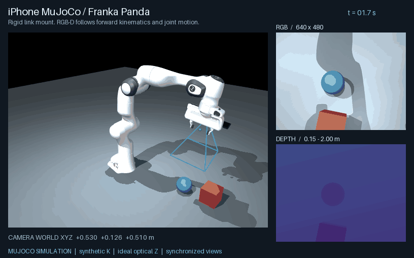

# 腕部 RGB-D 与机器人状态采集

相机刚性安装到机械臂末端。每帧 RGB、深度、关节角、速度与控制量取自同一个
`mjData` 状态，相机世界位姿由正向运动学和安装外参得到。

[](https://raw.githubusercontent.com/ddwty/iphone-mujoco/main/docs/images/robot-wrist.gif)

[GIF](https://raw.githubusercontent.com/ddwty/iphone-mujoco/main/docs/images/robot-wrist.gif)

## 从 Franka Panda 开始

下载 Panda 模型、导出相机配置并开始采集。

```bash
iphone-mujoco models --fetch panda
iphone-mujoco export-lab --output recordings/demo-rig
mjpython -m iphone_mujoco capture-wrist \
  --robot panda --profile recordings/demo-rig/calibration.json \
  --show-phone --duration 5 --fps 10 \
  --output recordings/wrist-panda
```

macOS 使用 `mjpython` 打开窗口，Linux/Windows 使用 `python`。
`--show-phone` 显示手机外壳，`--motion hold` 保持关节目标。
默认执行小幅关节运动。
每次运行使用新的或空的输出目录。

| 机械臂 | `--robot` | 默认安装 body | 夹爪 | 模型 |
|---|---|---|---|---|
| Franka Emika Panda，七轴 | `panda` | `hand` | 平行夹爪，上游 0–255 控制量 | Menagerie MJCF 与网格 |
| Universal Robots UR5e，六轴 | `ur5e` | `wrist_3_link` | 裸法兰 | Menagerie MJCF 与网格 |

模型采用 Google DeepMind 维护的 MuJoCo Menagerie 资源，固定上游提交、逐文件
校验并保留许可证。首次下载需要网络，随后复用本地缓存。
选择 UR5e 时先下载模型，再更改 `--robot`。

```bash
iphone-mujoco models --fetch ur5e
python -m iphone_mujoco capture-wrist \
  --robot ur5e --profile recordings/demo-rig/calibration.json \
  --show-phone --headless --fast --duration 5 --fps 10 \
  --output recordings/wrist-ur5e
```

## 批量生成和真实内参

离线生成数据时可以关闭交互窗口并取消真实时间等待。

```bash
python -m iphone_mujoco capture-wrist \
  --robot panda --profile recordings/demo-rig/calibration.json \
  --show-phone --headless --fast --duration 5 --fps 30 \
  --output recordings/wrist-offline
```

`--fps` 表示每个仿真秒采多少帧，采样时间保存在每帧状态中。
`--headless` 使用 OpenGL，Linux 服务器可配置 EGL 或 Xvfb/GLFW。

使用真实 iPhone 内参时，先在 asMagic Stream 开启 RGB/深度发送，然后采集 K。

```bash
python -m pip install -e '.[live]'
iphone-mujoco calibrate --ip YOUR_IP --output profiles/my-iphone.json
```

将采集命令的 `--profile` 换成此文件。示例配置的 RGB 为 640×480，深度为
256×192，真机尺寸取决于当前配置。更换手机或拍摄设置后重新采集标定。

## 手机控制机械臂并采集腕部图像

iPhone 打开 **Robot control → Through Mac** 并发送。连接后先松开 Square，
再按住移动，松开后保持当前目标。

```bash
mjpython -m iphone_mujoco capture-wrist \
  --robot panda --profile profiles/my-iphone.json \
  --show-phone --ip YOUR_IP --duration 0 \
  --output recordings/wrist-phone-control
```

Ctrl-C 结束并关闭录制。此工作流中手机提供控制输入，MuJoCo 提供腕部 RGB-D。
当前 App 的 Robot control 页发送位姿和控制量，Stream 页发送相机观测。

回放已录制的遥控输入并采集腕部图像。

```bash
mjpython -m iphone_mujoco capture-wrist \
  --robot panda --profile profiles/my-iphone.json \
  --show-phone --input-episode recordings/my-teleoperation --duration 0 \
  --output recordings/wrist-from-input
```

实时和回放输入保留速度、关节及断流限制，按本机时钟检查新鲜度。
该入口映射 Square、Cross 和夹爪，其他机械臂按钮实验使用 `teleop` 命令。

## 读取输出

```text
wrist-panda/
  rgb/00000000.png          # 无损 RGB uint8
  depth/00000000.png        # 原始 UInt16 深度
  calibration.json         # RGB K 与深度尺寸
  camera_info.json         # RGB/depth K、单位、来源与时间约定
  mount.json               # 光学相机到父 link 的固定变换及实测标记
  states.jsonl             # 时间、关节角/速度、控制量、光学位姿
  episode/                 # 统一 NPZ/JSON 数据格式
  preview_points.ply       # 第一帧的相机坐标点云
  run.json                 # 帧数、仿真时间和运行耗时
```

同一编号对应同一帧的图像和机器人状态。通过 `ReplaySource` 读取。

```python
from iphone_mujoco.recording import ReplaySource

with ReplaySource("recordings/wrist-panda/episode") as source:
    frame = source.poll().rgbd
    rgb, depth_m = frame.rgb, frame.depth_m
    K_rgb = frame.calibration.matrix
    K_depth = frame.calibration.depth_calibration().matrix
    world_from_camera = frame.world_from_camera
    qpos = frame.metadata["robot_state"]["qpos"]
    world_points = frame.point_cloud(world=True)
```

| 数据 | 约定 |
|---|---|
| RGB | `uint8 (H,W,3)`，RGB 通道，原始相机方向 |
| 深度 PNG | `uint16`，通过 `camera_info.json` 读取每单位米数 |
| 深度定义 | 光轴 Z，单位米，无效米制值为 NaN |
| 无返回 | PNG 中为 0，65535 保留 |
| 相机坐标 | X 右、Y 下、Z 前 |
| `world_from_camera` | 光学相机坐标到 MuJoCo Z-up 世界的 4×4 矩阵 |
| 时间 | 仿真秒，与对应状态的 `simulation_time` 相同 |

直接读取深度 PNG 时保留其 16 位数值，并使用保存的 scale。

```python
import json
from pathlib import Path
import numpy as np
from PIL import Image

root = Path("recordings/wrist-panda")
info = json.loads((root / "camera_info.json").read_text())
raw = np.asarray(Image.open(root / "depth/00000000.png"))
depth_m = raw.astype(np.float32) * info["depth"]["meters_per_unit"]
depth_m[raw == 0] = np.nan
```

`ReplaySource` 默认逐帧读取。`realtime=True` 使用录制时的本机接收/写盘间隔，
需要按仿真速度处理时使用各帧的仿真时间。

在采集命令追加 `--publish tcp://127.0.0.1:18000`，可让已有 PyPI SDK 订阅虚拟
相机。接收端使用 `asmagic.ARDataSubscriber("127.0.0.1", port=18000)`。
该 wire 路径使用 JPEG，数据集中的 RGB PNG 保持无损。

## 实测安装外参与自定义机器人

`parent_from_camera` 将 CV 光学相机坐标映射到父 link 坐标。

```text
T_world_camera = T_world_parent × T_parent_camera
```

默认相机朝向初始目标区域。Panda 的安装配置如下，`measured` 记录外参是否经过实测。

```json
{
  "parent_body": "hand",
  "parent_from_camera": [
    [1, 0, 0, 0.09],
    [0, 1, 0, 0],
    [0, 0, 1, 0.06],
    [0, 0, 0, 1]
  ],
  "camera_name": "wrist_camera",
  "measured": false
}
```

真实安装先进行测量或手眼标定，再使用 `--mount measured-mount.json`。
自定义机械臂需要 adapter JSON 和显式 mount。

```bash
mjpython -m iphone_mujoco capture-wrist \
  --robot path/to/adapter.json --mount path/to/mount.json \
  --profile profiles/my-iphone.json --show-phone \
  --duration 5 --fps 10 --output recordings/custom-wrist
```

执行器类型、TCP 和夹爪适配约定见开发文档。[机器人适配](development.md#adding-a-robot)
